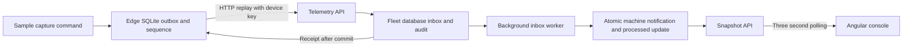
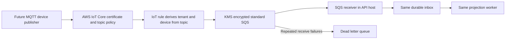

# LaundryOax architecture and code map

The source baseline is [545e6a3](https://github.com/CJAmy1996/LaundryOaxProject/commit/545e6a3521c6b8d744e8393e9784b478251a7859). The working local path and the proposed AWS transport share an inbox processor but have different acknowledgment semantics.

## Working local path



The edge executable is a separate process. API, inbox worker, and optional SQS receiver are hosted together. In local demo mode, FleetDb is SQLite and authentication uses a fixed loopback-only tenant/operator identity. A separate SQL Server connection remains available for the original disabled legacy API.

## AWS transport design



This path is source/configuration, not a deployed validation result. The repository does not contain the MQTT edge publisher or a downstream application-ACK topic. A broker PUBACK must not be substituted for the HTTP inbox receipt. The native IoT SQS action requires a standard queue; application ordering is deliberate. [AWS IoT SQS action](https://docs.aws.amazon.com/iot/latest/developerguide/sqs-rule-action.html).

## The three commit boundaries

| Boundary | Atomic work | Responsibility after commit | Failure after commit |
| --- | --- | --- | --- |
| Edge capture | Sequence increment plus outbox insert | Edge must retain and deliver event until application ACK | Reopen file and replay the same identity |
| API Accept | Inbox row plus accepted audit row | Fleet database is now responsible for projection and recovery | Lost HTTP ACK causes safe duplicate submission; lost SQS delete causes redelivery |
| Worker Process | Machine state plus processed timestamp, audit, optional notification | Fleet database contains the applied projection and notification | Next pass ignores already processed event |

No transaction includes HTTP delivery or the SQS DeleteMessage operation. Idempotency closes those retry windows for retained identities; it does not create a cross-system disaster recovery guarantee.

## Concrete event example

```json
{
  "eventId": "1c67e185-0901-4cbd-8f43-3e7c0d7202f1",
  "tenantId": "oaxaca-central",
  "deviceId": "W-EDGE",
  "sequence": 1,
  "observedAt": "2026-09-05T20:00:00Z",
  "phase": "washing",
  "progress": 25,
  "temperatureC": 32,
  "moisturePercent": 65,
  "turbidityNtu": 100
}
```

This is an explanatory payload, not evidence of physical sensor capture. Register a dedicated device and configure its key before a real local submission. A receipt contains eventId, sequence, and duplicate; it acknowledges persistence, not completed processing. One authoritative writer should own each device sequence stream.

## Invariants and assumptions

- **Identity:** TenantId plus EventId identifies an immutable typed payload; a hash detects conflicting reuse.
- **Sequence ownership:** TenantId plus DeviceId plus Sequence is unique. A new stream begins at one.
- **Application order:** only LastSequence + 1 is eligible. No global order is claimed across machines.
- **Atomic projection:** machine state, processed marker, and a qualifying notification are committed together.
- **Tenant access:** queries use signed/authenticated tenant identity. There is no database RLS policy or global query filter.
- **Limits:** no device epoch, CycleId, explicit schemaVersion, deduplication retention job, or gap recovery endpoint.
- **Durability assumptions:** healthy persisted storage, correct filesystem/database behavior, and retention of the authoritative data. A historical database restore can violate the retained-event assumption.

## Source landmarks

The companion source-map table below is generated from exact symbols in the pinned revision. Follow those links during a code walkthrough; do not memorize line numbers.

| Subject | Pinned source |
| --- | --- |
| Atomic edge capture | [edge/Outbox.cs:24](https://github.com/CJAmy1996/LaundryOaxProject/blob/545e6a3521c6b8d744e8393e9784b478251a7859/edge/Outbox.cs#L24) |
| Ordered replay eligibility | [edge/Outbox.cs:42](https://github.com/CJAmy1996/LaundryOaxProject/blob/545e6a3521c6b8d744e8393e9784b478251a7859/edge/Outbox.cs#L42) |
| Persisted backoff | [edge/Outbox.cs:59](https://github.com/CJAmy1996/LaundryOaxProject/blob/545e6a3521c6b8d744e8393e9784b478251a7859/edge/Outbox.cs#L59) |
| Application acknowledgment check | [edge/Program.cs:29](https://github.com/CJAmy1996/LaundryOaxProject/blob/545e6a3521c6b8d744e8393e9784b478251a7859/edge/Program.cs#L29) |
| Durable inbox and deduplication | [IoT/EventPipeline.cs:15](https://github.com/CJAmy1996/LaundryOaxProject/blob/545e6a3521c6b8d744e8393e9784b478251a7859/IoT/EventPipeline.cs#L15) |
| Ordered transactional projection | [IoT/EventPipeline.cs:56](https://github.com/CJAmy1996/LaundryOaxProject/blob/545e6a3521c6b8d744e8393e9784b478251a7859/IoT/EventPipeline.cs#L56) |
| Keys constraints and concurrency | [IoT/FleetDb.cs:9](https://github.com/CJAmy1996/LaundryOaxProject/blob/545e6a3521c6b8d744e8393e9784b478251a7859/IoT/FleetDb.cs#L9) |
| Device authentication | [IoT/Security.cs:30](https://github.com/CJAmy1996/LaundryOaxProject/blob/545e6a3521c6b8d744e8393e9784b478251a7859/IoT/Security.cs#L30) |
| Tenant snapshot | [IoT/FleetEndpoints.cs:10](https://github.com/CJAmy1996/LaundryOaxProject/blob/545e6a3521c6b8d744e8393e9784b478251a7859/IoT/FleetEndpoints.cs#L10) |
| Optional SSE feed | [IoT/FleetEndpoints.cs:59](https://github.com/CJAmy1996/LaundryOaxProject/blob/545e6a3521c6b8d744e8393e9784b478251a7859/IoT/FleetEndpoints.cs#L59) |
| SQS receive and delete boundary | [IoT/SqsWorker.cs:17](https://github.com/CJAmy1996/LaundryOaxProject/blob/545e6a3521c6b8d744e8393e9784b478251a7859/IoT/SqsWorker.cs#L17) |
| Role policies | [Program.cs:55](https://github.com/CJAmy1996/LaundryOaxProject/blob/545e6a3521c6b8d744e8393e9784b478251a7859/Program.cs#L55) |
| Readiness scope | [Program.cs:82](https://github.com/CJAmy1996/LaundryOaxProject/blob/545e6a3521c6b8d744e8393e9784b478251a7859/Program.cs#L82) |
| Polling UI | [client/src/main.ts:60](https://github.com/CJAmy1996/LaundryOaxProject/blob/545e6a3521c6b8d744e8393e9784b478251a7859/client/src/main.ts#L60) |
| Baseline estimators | [IoT/Models.cs:72](https://github.com/CJAmy1996/LaundryOaxProject/blob/545e6a3521c6b8d744e8393e9784b478251a7859/IoT/Models.cs#L72) |
| Local test cases | [tests/ReliabilityTests.cs:60](https://github.com/CJAmy1996/LaundryOaxProject/blob/545e6a3521c6b8d744e8393e9784b478251a7859/tests/ReliabilityTests.cs#L60) |
| Topic-derived cloud identity | [infra/main.tf:68](https://github.com/CJAmy1996/LaundryOaxProject/blob/545e6a3521c6b8d744e8393e9784b478251a7859/infra/main.tf#L68) |
| Proposed container runtime | [infra/ecs.tf:124](https://github.com/CJAmy1996/LaundryOaxProject/blob/545e6a3521c6b8d744e8393e9784b478251a7859/infra/ecs.tf#L124) |

## Sizing practice with explicitly hypothetical inputs

**Offline buffer:** event rate × outage duration × stored bytes per event, plus indexes, WAL, metadata, and headroom. One 1 KiB event every ten seconds for twenty-four hours gives 8,640 events and 8,847,360 raw bytes, approximately 8.44 MiB per device. This excludes actual database overhead and is not a supported capacity claim.

**Ingestion rate:** N/t. Ten thousand hypothetical devices at a ten-second interval would create 1,000 events per second before duplicates/reconnect bursts. No such load test has been performed.

**Drain time:** B/(mu-lambda), only if service rate mu exceeds arrival rate lambda and events are eligible. A hypothetical 60,000-event backlog with mu=500/s and lambda=100/s drains in 150 seconds under ideal conditions. Sequence gaps, database locks, and CPU/network limits can invalidate this estimate.

**Write amplification:** each normal event creates the inbox and accepted audit, then updates machine and inbox and inserts processed audit; phase transitions may insert a notification. Edge counter/outbox/ACK writes and indexes/logs add more work. Measure bytes and IOPS rather than assuming one disk write per event.

## Decisions to defend

| Choice | Benefit in this prototype | Cost or alternative |
| --- | --- | --- |
| SQLite edge outbox | Embedded durable capture | Capacity, storage health, and backup remain operating concerns |
| Commit before receipt | Clear transfer of delivery responsibility | Requires durable cloud restore/reconciliation after edge deletion |
| Contiguous sequencing | Avoids silent reordering | Gaps need explicit repair; no automatic skip |
| Database uniqueness | Arbitrates competing identities | Exceptions and retry behavior require provider-specific tests |
| Serializable worker transaction | Simple correctness boundary | Contention and deadlocks under multiple workers |
| Shared server host | Easy local operation | Receiver/projector/API cannot scale independently yet |
| Polling console | Simple catch-up from durable state | Extra reads, stale intervals, and incomplete real-time semantics |
| Standard SQS integration | Fits native IoT action | Application must handle ordering and duplicates |

## Authoritative references

- [SQLite WAL](https://www.sqlite.org/wal.html) and [synchronous PRAGMA](https://www.sqlite.org/pragma.html#pragma_synchronous) explain the storage mode used by the edge; hardware/filesystem assumptions still matter.
- [EF Core transactions](https://learn.microsoft.com/en-us/ef/core/saving/transactions) and [concurrency](https://learn.microsoft.com/en-us/ef/core/saving/concurrency) explain the mechanisms used in Accept and Process. Provider integration tests are still necessary.
- [SQS standard delivery](https://docs.aws.amazon.com/AWSSimpleQueueService/latest/SQSDeveloperGuide/standard-queues.html) documents duplicates and possible reordering; those assumptions motivate the application's identity/sequence checks.
